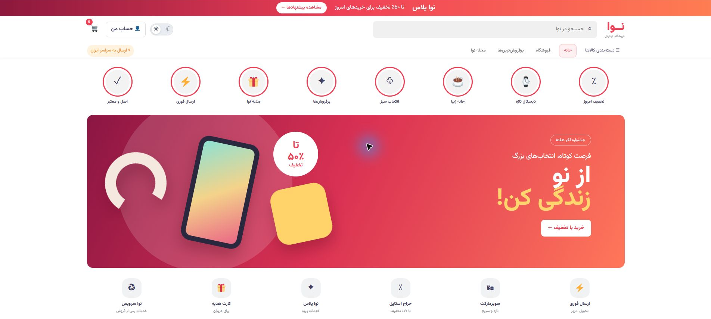
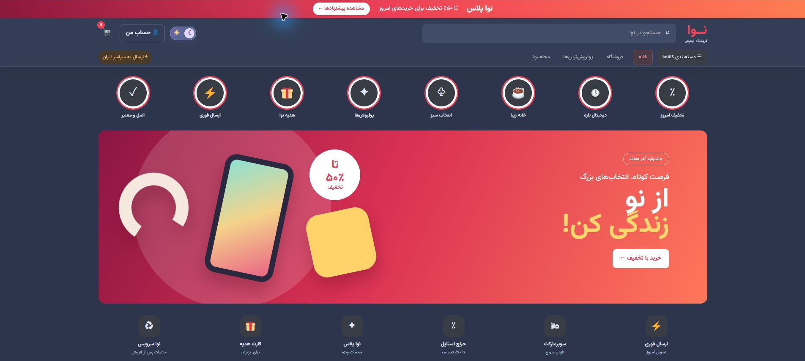
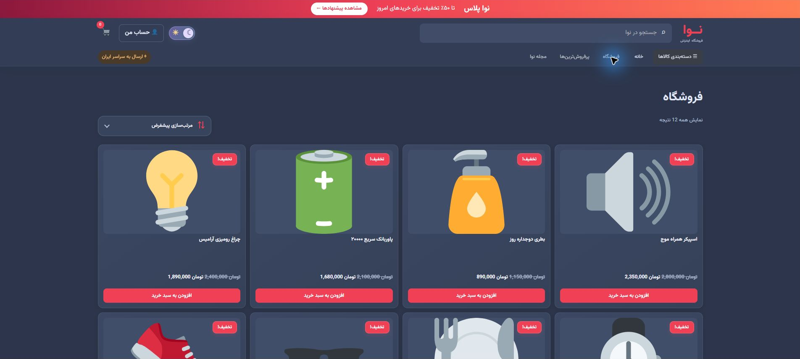
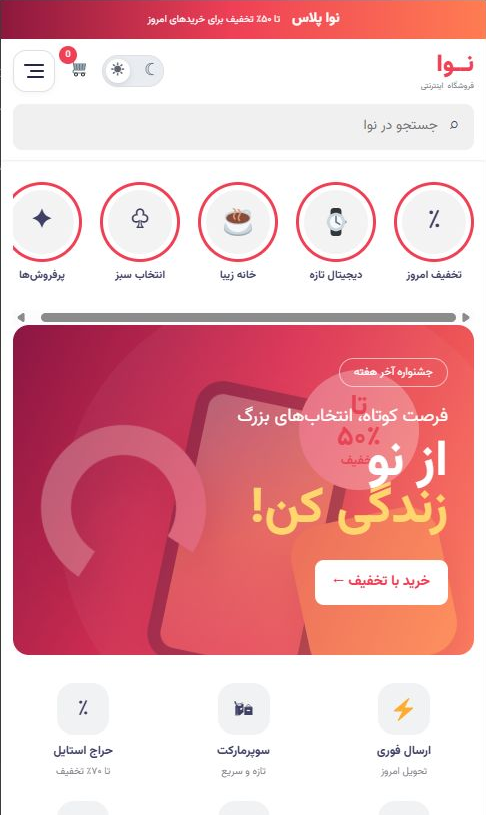
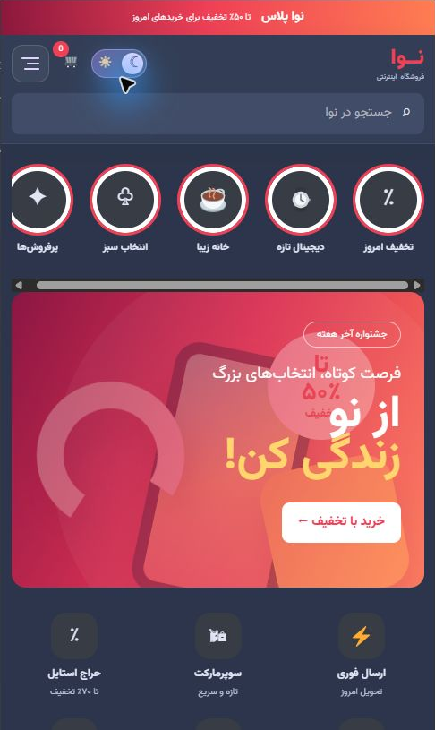
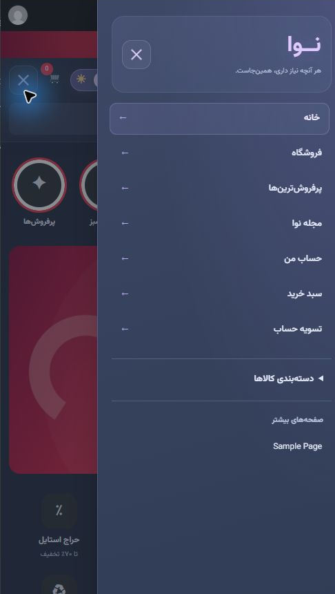

<div align="center">

# نوا | Nova Store

### A Persian WooCommerce storefront with a custom WordPress theme

RTL · Responsive layout · Light & dark themes · Customer accounts · Editorial magazine

</div>



## معرفی پروژه

نوا یک نمونه‌کار فروشگاه اینترنتی فارسی است که روی WordPress و WooCommerce ساخته شده است.
قالب اختصاصی پروژه، ویترین فروشگاه، حساب مشتری، مجله و رابط موبایل را در یک ظاهر هماهنگ ارائه می‌کند.
این مخزن شامل **کد قالب اختصاصی** است؛ هستهٔ وردپرس، افزونه‌ها، رمزها، دیتابیس و اطلاعات مشتریان در آن قرار ندارند.

**برای دیدن نمونه‌کار نیازی به نصب ندارید:** تصاویر زیر را ببینید یا فایل [گالری پروژه](docs/index.html) را پس از دریافت مخزن در مرورگر باز کنید.
تصاویر از اجرای واقعی نسخهٔ محلی گرفته شده‌اند. این گالری، نمایش تصویری پروژه است؛ فروشگاه آنلاین و فعال نیست.

## Preview / تصاویر پروژه

### حالت تیره



### فروشگاه و مرتب‌سازی محصولات



### نسخهٔ موبایل و منوی کشویی

<p align="center">
  
  
  
</p>

## امکانات

- رابط فارسی و راست‌به‌چپ با چیدمان موبایل، تبلت و دسکتاپ
- انتخاب حالت روشن و تیره با ذخیرهٔ تنظیم کاربر در مرورگر
- منوی کشویی موبایل، انیمیشن آیکون و پشتیبانی از Escape و صفحه‌کلید
- فهرست محصولات، دسته‌بندی، مرتب‌سازی، صفحهٔ محصول و سبد خرید با WooCommerce
- جستجوی زندهٔ محصول با درخواست AJAX
- حساب مشتری، فرم ثبت‌نام و ویرایش اطلاعات و شماره تماس
- مجله با جستجو، فیلتر موضوع، صفحه‌بندی و مطالب مرتبط
- مدیریت تصویر و دستهٔ مقاله از پنل وردپرس
- نمایش خودکار تازه‌ترین مقاله‌ها در صفحهٔ اصلی
- احترام به تنظیم کاهش حرکت کاربر در انیمیشن‌ها

## Stack

| بخش | فناوری |
| --- | --- |
| مدیریت محتوا | WordPress |
| محصولات، حساب و سفارش‌ها | WooCommerce |
| قالب و اتصال‌ها | PHP، WordPress hooks و template hierarchy |
| رابط کاربر | HTML، CSS و JavaScript بدون فریم‌ورک |
| دیتابیس محیط اجرا | MySQL / MariaDB |

## نصب

1. WordPress و WooCommerce را در محیط محلی یا هاست سازگار نصب کنید.
2. پوشهٔ `nova` را به `wp-content/themes/nova` منتقل کنید.
3. از **نمایش ← پوسته‌ها**، قالب **Nova Store** را فعال کنید.
4. برگه‌های فروشگاه، سبد و تسویه حساب را از تنظیمات WooCommerce بررسی کنید.
5. یک برگهٔ «خانه» بسازید و از **تنظیمات ← خواندن** به‌عنوان صفحهٔ اصلی ثابت انتخاب کنید.
6. در **تنظیمات ← پیوندهای یکتا**، تنظیمات را ذخیره کنید.

راهنمای کامل‌تر: [نصب و مدیریت محتوا](docs/SETUP.md).

## ساختار کد

```text
nova/
├── functions.php              # نسخهٔ قالب و بارگذاری بخش‌ها
├── front-page.php             # ویترین صفحهٔ اصلی
├── woocommerce.php            # محتوای فروشگاهی
├── page-magazine.php          # جستجو و فهرست مقاله‌ها
├── single.php                 # خواندن مقاله و مطالب مرتبط
├── inc/
│   ├── setup.php              # تنظیمات و فایل‌های CSS / JS
│   ├── woocommerce.php        # کارت محصول و اتصال‌های فروشگاه
│   ├── search.php             # جستجوی زنده
│   ├── customer-account.php   # فرم و تنظیم حساب مشتری
│   ├── magazine.php           # برگه و ابزارهای مجله
│   ├── magazine-admin.php     # عکس و دسته در مدیریت مقاله
│   └── demo-products.php      # محصولات نمونهٔ نصب اولیه
├── template-parts/            # کارت مقاله و منوی موبایل
└── assets/
    ├── css/                  # پایه، فروشگاه، مجله، موبایل و تم تیره
    └── js/                   # تعامل‌های سایت و مدیریت تصویر مقاله
```

## وضعیت نمونه‌کار

این پروژه نمونه‌کار در حال توسعه است. کدهای PHP و JavaScript از نظر نحوی بررسی شده‌اند
و تصاویر، نمایش واقعی رابط در محیط محلی را نشان می‌دهند. تست کامل پرداخت، ایمیل و چرخهٔ
سفارش در محیط عملیاتی انجام نشده است. نمونهٔ محصولات برای نمایش چیدمان از آیکون استفاده می‌کند؛
برای انتشار فروشگاه واقعی باید عکس‌ها، محتوا، اطلاعات تماس و اتصال پرداخت جایگزین شوند.

## English overview

Nova is a Persian, RTL storefront built with WordPress and WooCommerce. This repository contains
the custom theme source and screenshots, rather than a full WordPress installation or a database dump.
The theme includes a responsive catalog, live product search, customer account customization,
a slide-out mobile menu, persistent light/dark modes, and an editorial magazine managed through WordPress posts.

To install, copy `nova/` to `wp-content/themes/`, install WooCommerce, activate the theme, configure
the store pages and a static front page, then save permalink settings. See [setup notes](docs/SETUP.md)
for first-run behavior and deployment limitations. No live checkout or production-readiness claim is made.

WordPress and WooCommerce are external dependencies and are not bundled here. The theme loads the
Vazirmatn font through Google Fonts; demo icons use the operating system's emoji font.
